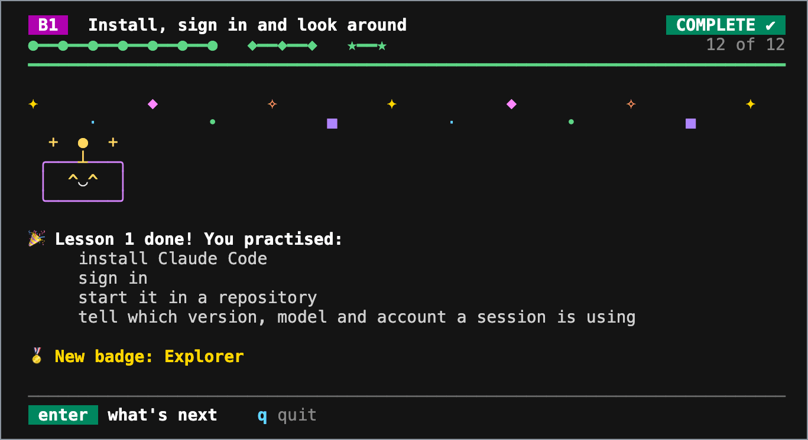

# Claude Code practice

The practice repository for [Claude Code: Everything You Need to Know](https://github.com/wesammustafa/Claude-Code-Everything-You-Need-to-Know). The lessons live in the guide; this repository holds the small app you practice on and a check for every core lesson and capstone.

<p align="center">
  <!-- Captured from the learning app at template commit 21ad2d3 on 2026-10-17: the app's own frames, played in order. -->
  
  <br />
  <sub>The learning app, <code>npm run learn</code>, at the end of Beginner lesson 1.</sub>
</p>

## Start

1. Select **Use this template** > **Create a new repository** to make your own copy, then clone it.
2. Or open your copy in a Codespace: Node.js, Claude Code and the sandbox's dependencies come preinstalled.

You need Node.js LTS and git. There is nothing to install with npm: the app and its checks use only Node.js itself.

## Learn step by step

Run the learning app in one terminal, and use Claude Code in a second terminal beside it:

```bash
npm run learn
```

It shows one step of a lesson at a time, watches your copy, and turns a step green as soon as your work is there. The help shrinks each time a skill comes back: every command at first, then hints, then only the goal. Every Beginner lesson and the capstone are in the app. From lesson 2 on, each opens with two warm-up questions from earlier lessons. Help fades within each level: each lesson after a level's first is planned to give less help than that first one. A lesson you skipped doesn't count toward that, so a skill from it can come back with more help. The Intermediate and Advanced lessons are on the map too, one level a page: while you follow a lesson's page, the app watches its check, and counts the lesson done once the whole check passes (press `r` for the slower parts).

- Keys: arrows or numbers to choose, `enter` to go on, `h` for a hint, `m` for the map of lessons, `q` to quit. Your place is saved in `.practice/learn.json`.
- If PowerShell refuses to run `npm`, run `npm.cmd run learn`.
- Odd symbols or colors? Set `LEARN_PLAIN=1` (in PowerShell, `$env:LEARN_PLAIN=1`) before `npm run learn`. The app also follows `NO_COLOR`.
- Prefer a still screen? Start with `npm run learn -- --calm`, or set `LEARN_CALM=1` the same way as `LEARN_PLAIN`.
- The app has no AI in it and changes none of your work: it reads your files, runs the lesson's check and git's read-only commands (`git status`, and whether a work folder is a repository that ignores `.practice/`), and writes only its own file.

From Intermediate on, the lessons ask you to practise in one of your own repositories. Each later level has its own work folder, this practice copy until you pick another:

- Press `f` on a level's page of the map, or on a lesson's check, and type or paste the folder's path. The map shows each level's folder. The first lesson of a level that you open in the app asks too, until the level has a folder.
- To pick it ahead of time, start with `npm run learn -- --dir <path>`, a path relative to this copy or in full. It sets the work folder of the level the app opens on.
- The app then checks, watches and runs `git status` there, and says which folder each step happens in.
- The Intermediate capstone always runs in this copy. Lesson 5 and the capstone of Advanced run in a new copy of the template: each asks for that copy's folder, which can't be this copy, and checks nothing until you give it.
- Your progress stays in this copy, so run `npm run learn` from here. Only the folders you picked are saved with it.

## Check your work

Each core lesson and each capstone ends with a check. Run it from the root of your copy:

```bash
npm run check -- b-1
```

Each item prints `PASS` or `FAIL`, with a hint for what to fix. To check a lesson you did in one of your own repositories, run the same command from your copy with `--dir` and the path to that repository, relative to your copy or in full. Here it is a folder next to your copy:

```bash
npm run check -- b-1 --dir ../my-project
```

Some items read a file you save under `.practice/`, for state that exists only for a moment, such as a plan before you approve it. Git ignores that folder, so those items are checked on your machine only.

## Track your progress

- Every push runs the **Progress** workflow, which lists each check's result in the run's summary. It never fails: an exercise you have not finished shows as "not yet", and items that read `.practice/` show as "checked locally".
- Open an issue from the **Track my progress** template for a checklist of every lesson and capstone.
- The `solutions` branch of [the template](https://github.com/wesammustafa/claude-code-practice) holds a reference solution for every check. Read it after an honest attempt.

## The app

A small Markdown link checker. It reports relative links whose file is missing:

```bash
npm run linkcheck -- samples
npm test
```

The app is `src/`, `test/` and `samples/`. The rest belongs to the course: `checks/` holds the checks, `learn/` the step-by-step learning app, `capstone/` the capstone briefs, and `.github/` the workflows. The **Assert checks** workflow does its work only in the template repository: in your copy its job is skipped, which GitHub shows as a skipped check, so you can commit your exercises on any branch, `main` included.

## In a Codespace

- The Claude Code Dev Container Feature always installs the latest Claude Code release ([Dev containers](https://code.claude.com/docs/en/devcontainer)). The guide is checked against the `stable` release, which is the same or older, so the lessons still apply.
- If the browser sign-in finishes but the terminal keeps waiting, copy the code the browser shows and paste it at the `Paste code here if prompted` prompt ([Dev containers](https://code.claude.com/docs/en/devcontainer)).
- If sandboxed commands fail with `Can't mount proc on /newroot/proc: Operation not permitted`, the container is blocking the sandbox's own `/proc` mount. Setting `sandbox.enableWeakerNestedSandbox` to `true` works around it, but use it only when the container already provides the isolation you need ([Sandboxing](https://code.claude.com/docs/en/sandboxing)).
- Codespaces compute time counts against your GitHub account's included usage ([Codespaces billing](https://docs.github.com/en/billing/concepts/product-billing/github-codespaces)).

## License

MIT. See [LICENSE](LICENSE). Claude Code is a product of Anthropic; this is an independent community project, not affiliated with or endorsed by Anthropic.

Sources: [Dev containers](https://code.claude.com/docs/en/devcontainer), [Sandboxing](https://code.claude.com/docs/en/sandboxing), [Codespaces billing](https://docs.github.com/en/billing/concepts/product-billing/github-codespaces)
